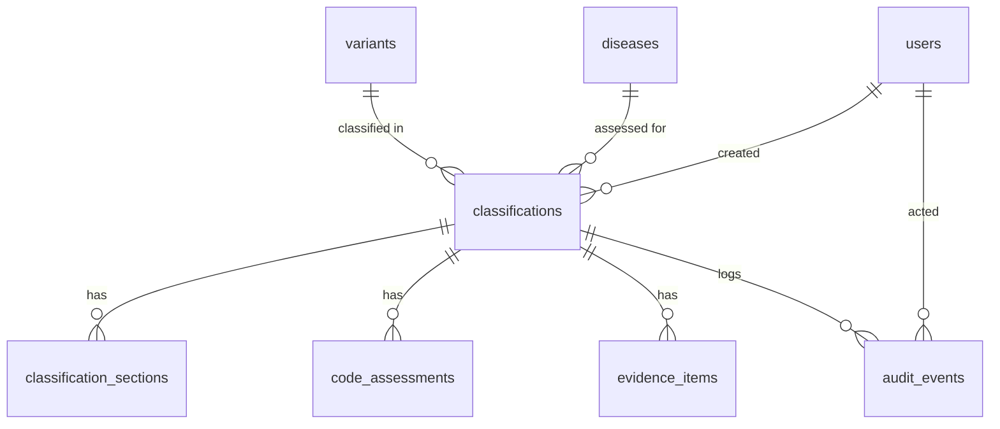

# VCI v4 Data Model

**Status:** Draft for review (Phase 1). Covers the tables needed to stand up the current UI. Tables that arrive with later features are listed at the end.

## Terms

- **Classification record** (`classifications`): the work a curator does on one variant, for one disease and mode of inheritance (MOI), under one affiliation. VCI v3 called this an interpretation.
- **Classification result** (`classifications.result`): the verdict the record reaches, from benign to pathogenic.
- **Evidence code**: one of the SVCv4 codes, such as `POP_FRQ` or `CLN_AFF`.

These names may change after feedback. A rename is a single migration, and table names never leave the system, because publishing goes through the SVCv4 transform.

## Diagram



Where each kind of data lives:

| Data | Table |
|------|-------|
| Who, what variant, which disease and MOI, status, result | `classifications` |
| Form state for a whole section (Population inputs, Predicted Effect drafts) and Mark Complete | `classification_sections` |
| The outcome for each evidence code: status, points, override, comment | `code_assessments` |
| Repeated entries: probands, case-control studies, functional evidence, informative variants | `evidence_items` |
| Everything that happened, in order | `audit_events` |

## Conventions

- **Primary keys are UUIDs** (`gen_random_uuid()`). IDs appear in URLs, and UUIDs don't reveal record counts or let anyone step through records by incrementing a number.
- **Timestamps are `timestamptz`**, stored in UTC. Every table has `created_at` (`occurred_at` on audit events). Tables whose rows change have `updated_at`, set by the application on every update through a shared model mixin, so new tables get it automatically.
- **Triggers are used only for guarantees that must hold even if application code is wrong**, such as the append-only audit table.
- **Fixed value sets are `text` with a `CHECK` constraint**, not Postgres `ENUM` types. Adding a value is a one-line migration, while Postgres can't remove a value from an enum.
- **Every foreign key column is indexed.**
- **Classification data is never hard-deleted.** Evidence uses `deleted_at`, so audit events and snapshots always point at a real row.
- **JSONB columns carry a schema version.** The API validates their shape with Pydantic; the database only checks that they are valid JSON.

## Tables

### users

| Column | Type | Notes |
|--------|------|-------|
| id | uuid PK | |
| clerk_user_id | text, unique, not null | Until Clerk lands in Phase 3, the seed creates placeholder users |
| email | text | |
| display_name | text | Shown in audit entries |
| created_at, updated_at | timestamptz | |

### variants

One row per variant, shared by every affiliation that classifies it.

| Column | Type | Notes |
|--------|------|-------|
| id | uuid PK | |
| caid | text, unique, not null | ClinGen Allele Registry ID, e.g. `CA000123` |
| clinvar_variation_id | text, null | |
| preferred_title | text, not null | e.g. `NM_000546.6(TP53):c.215C>G` |
| gene_symbol | text, null | |
| hgnc_id | text, null | |
| chromosome, position, ref, alt | text, bigint, text, text, all null | GRCh38. Null for variants that don't fit this shape |
| created_at, updated_at | timestamptz | |

External data (gnomAD, VEP, ClinVar) is not stored here. It gets its own cache in Phase 2.

### diseases

| Column | Type | Notes |
|--------|------|-------|
| id | uuid PK | |
| mondo_id | text, unique, not null | e.g. `MONDO:0018875` |
| label | text, not null | |
| created_at | timestamptz | |

Rows are added when a curator picks a term.

### classifications

| Column | Type | Notes |
|--------|------|-------|
| id | uuid PK | |
| variant_id | uuid FK → variants, not null | |
| affiliation_id | text, not null | ID from the Affiliations Service. Becomes a foreign key when the affiliations table lands in Phase 4 |
| disease_id | uuid FK → diseases, null | Set on General Information |
| moi | text, null | HPO term ID (e.g. `HP:0000006`) or `other` |
| moi_other_text | text, null | Required when `moi = 'other'` |
| transcript | text, null | Selected transcript accession |
| cspec_id, cspec_version | text, null | The specification used. The default SVCv4 baseline until VCEP CSpecs land |
| status | text, CHECK, not null | `in_progress`, `provisional`, `approved`. Default `in_progress`. Publication is tracked per snapshot, not here (see Decisions) |
| result | text, CHECK, null | `benign`, `likely_benign`, `variant_of_uncertain_significance`, `likely_pathogenic`, `pathogenic`. Same values as the SVCv4 enum. Null means not yet determined |
| total_points | numeric(6,2), null | Sum of code points, saved with each change |
| summary_statement | text, null | |
| created_by | uuid FK → users | |
| created_at, updated_at | timestamptz | |

**Uniqueness:** one record per variant + disease + MOI + affiliation. A new record starts without a disease or MOI, because the tabs stay locked until they're set. So this is a partial unique index that applies once both are set:

```sql
CREATE UNIQUE INDEX classifications_unique_scope
  ON classifications (variant_id, affiliation_id, disease_id, moi, coalesce(moi_other_text, ''))
  WHERE disease_id IS NOT NULL AND moi IS NOT NULL;
```

When a curator sets a disease and MOI that already exist for that affiliation, the API returns a conflict that links to the existing record.

### classification_sections

One row per sidebar section that a curator has touched.

| Column | Type | Notes |
|--------|------|-------|
| classification_id | uuid FK → classifications | Primary key, together with `section` |
| section | text, CHECK | `general_information`, `population`, `clinical`, `predicted_effect`, `functional`, `informative_variants` |
| inputs | jsonb, not null, default `{}` | Section form state, e.g. `NonsenseDraft` or `MissenseDualPathwayData` from `frontend/src/lib/scoring.ts` |
| inputs_schema_version | integer, not null, default 1 | |
| complete | boolean, not null, default false | Mark Complete |
| completed_by | uuid FK → users, null | |
| completed_at | timestamptz, null | |
| updated_at | timestamptz | |

### code_assessments

The outcome for one evidence code. A code with no row has not been evaluated, which the UI shows as NE.

| Column | Type | Notes |
|--------|------|-------|
| id | uuid PK | |
| classification_id | uuid FK → classifications | |
| code | text, not null | e.g. `POP_FRQ`. The API checks it against the active CSpec's codes |
| status | text, CHECK, not null | `score`, `nd` (no data), `na` (not applicable). Same values as the code status selector |
| computed_points | numeric(5,2), null | Points from the scoring rules |
| override_points | numeric(5,2), null | Curator override |
| override_reason | text, null | Required when `override_points` is set |
| comment | text, null | Per-code comment |
| updated_by | uuid FK → users | |
| created_at, updated_at | timestamptz | |

Unique on `(classification_id, code)`. The effective score is `override_points` if set, otherwise `computed_points`.

### evidence_items

Each entry a curator adds through a modal.

| Column | Type | Notes |
|--------|------|-------|
| id | uuid PK | |
| classification_id | uuid FK → classifications | |
| kind | text, CHECK, not null | `proband`, `case_control`, `functional`, `informative_variant` |
| data | jsonb, not null | The entry itself, shaped like the frontend types `Proband`, `FunctionalEvidenceEntry` and so on |
| schema_version | integer, not null, default 1 | |
| pmid | text, null | Kept as a column so the Literature tab can find which papers are already used |
| source | jsonb, null | The other source details: lab, database, free text |
| created_by, updated_by | uuid FK → users | |
| created_at, updated_at | timestamptz | |
| deleted_at | timestamptz, null | Soft delete |

Indexed on `classification_id` (live rows only) and on `pmid`.

### audit_events

Append-only. Rows are never changed or removed.

| Column | Type | Notes |
|--------|------|-------|
| id | bigint, identity | Insertion order |
| classification_id | uuid FK → classifications | |
| actor_id | uuid FK → users, null | Null for system actions |
| occurred_at | timestamptz, not null, default now() | |
| action | text, not null | e.g. `moi_set`, `proband_added`, `section_completed` |
| codes | text[], null | Evidence codes affected |
| entity_type, entity_id | text, uuid, null | The row that changed |
| detail | text, null | Human-readable summary |
| before, after | jsonb, null | Only the fields that changed, not whole documents. Full copies belong in snapshots |

The rules are enforced three ways:
- A trigger rejects any `UPDATE` or `DELETE` on the table.
- On AWS, the application's database role is granted only `INSERT` and `SELECT` on it.
- Each event is written in the same transaction as the change it records, so the log can't miss a change or record one that didn't happen.

Events are written when a curator saves, not on every keystroke or autosave. With changed-fields-only payloads, an event is roughly 0.5–2 KB. A heavily worked classification of about 1,000 events comes to about 1 MB.

## JSONB or a column?

A field becomes a real column when we filter, join, sort, enforce uniqueness or report on it. Everything else that comes from a form lives in JSONB.

- **Form answers** (`evidence_items.data`, `classification_sections.inputs`) follow the TypeScript types in `frontend/src/lib/scoring.ts`. The API validates them with one Pydantic model per kind.
- **When a form's shape changes**, new writes get the next `schema_version`. Old rows keep theirs, and the API upgrades them when they're read, or a one-off script backfills them.
- **CSpec documents** (later) use the same approach with one difference. They are Baylor's documents, not ours, so they are stored exactly as received, never edited, and each version is a new row. A few fields (CSpec ID, version, affiliation) are copied into columns for lookup.

## Mapping to the SVCv4 model

Publishing transforms our data into the [SVCv4 model](https://github.com/clingen-data-model/svcv4-model), which is still in development.

| Ours | SVCv4 |
|------|-------|
| `classifications` | `Statement` |
| `variants` | `Proposition` subject (variant being classified; needs a VRS ID, added later) |
| `diseases` | `Proposition` object (Mendelian disease entity) |
| `moi` | `Proposition` qualifier |
| `result` | `VariantPathogenicityClassification` |
| `total_points` | `Statement.score` |
| `cspec_id`, `cspec_version` | `Statement.specifiedBy` |
| `code_assessments` | `EvidenceLine` (code, effective score) |
| `evidence_items` | Evidence items (`DataItem`) |

## Known risks

- **Points are calculated in the browser.** `frontend/src/lib/scoring.ts` computes them and the API saves what it receives. That's acceptable for alpha. Before anything is approved or published (Phase 5), the server must recompute the points, either with a Python port of the scoring rules or by running the same TypeScript on the server.
- **The SVCv4 model is still changing.** The transform is the only code that depends on it, so changes there don't reach the tables.

## Later tables

| Table | Phase | Purpose |
|-------|-------|---------|
| `external_responses` | 2 | Cached gnomAD, VEP, ClinVar, Allele Registry and LDH responses with expiry |
| `cspecs` | 2 | CSpec documents as received, one row per version |
| `notes` | 3 | Internal notes on the Audit Trail tab, threaded, tagged by code and source |
| `literature_reviews` | 3 | Review status of candidate papers per classification |
| `affiliations`, `user_affiliations` | 4 | Affiliations Service data and memberships |
| `snapshots` | 5 | Frozen copy of a classification at each provisional and approval (`stage`), as JSONB |
| `publications` | 5 | Each attempt to publish an approved snapshot: target (Evidence Repository or ClinVar), state (`pending`, `published`, `failed`, `withdrawn`), external ID, time |
| `clinvar_batches` | 5 | ClinVar submission batches per affiliation |
| `variants.vrs_id` | 5 | VRS identifier for the SVCv4 subject |

## Decisions

1. **MOI "Other":** the free text counts toward uniqueness, so "Other: digenic" and "Other: mosaic" are different records.
2. **Reopening:** a published classification can be reopened. It goes back to `in_progress` on the same record, and must be made provisional, approved and published again. The previously published snapshot stays published until a newer approved snapshot is published.
3. **Approval:** usually done by the VCEP coordinator. Role-based permissions come after Clerk is integrated, if needed.
4. **Snapshots and publishing:** provisional and approval each create a snapshot. Publishing is a separate step: the curator clicks Publish, which publishes the current approved snapshot without creating a new one. v3 marks that snapshot with a `published: true` flag. v4 records the same fact as a row in `publications` linked to the approved snapshot, which can also hold:
   - Pending and failed states, since publishing goes to an outside system.
   - Separate outcomes for the Evidence Repository and ClinVar.
   - A withdrawal, without editing the snapshot.

   A snapshot counts as published when it has a successful publication.
